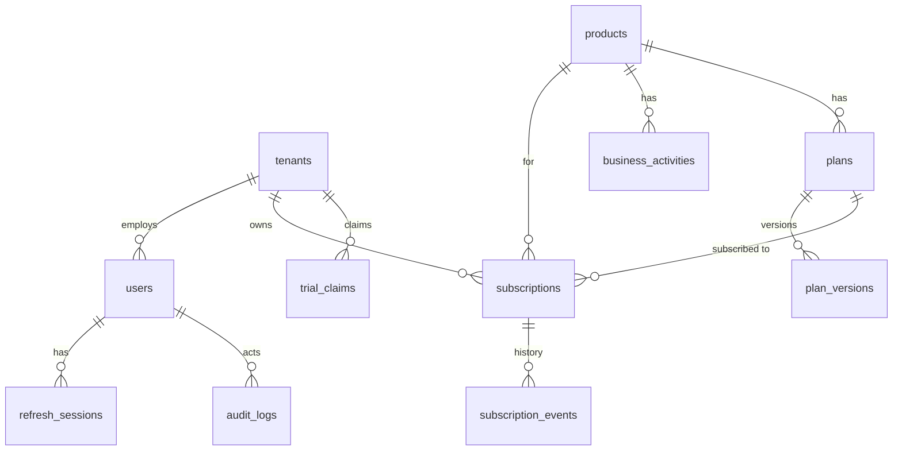

# ADR-0003: مخطط قاعدة البيانات الأولي وتدفق الصلاحيات

- **الحالة:** مقبول بإجابات المدير على الأسئلة المفتوحة (2026-10-18). نقطتان بافتراض معلن، انظر «القرارات المحسومة».
- **التاريخ:** 2026-10-18 (عُدِّل بعد إجابات المدير في نفس اليوم)
- **مرتبط بـ:** ADR-0002، `TASKS.md` (المرحلة A، والأقسام 7 و8)

## السياق

قاعدة MariaDB وDrizzle والـ migrations جاهزة. هذا المستند يحدد المخطط الأول وتدفق التفويض للمراحل C (الحسابات والشركات) وD (الأنظمة والباقات والتجربة) فقط؛ الباقي مؤجل (انظر «خارج النطاق»).

## القرارات المحسومة من المدير

| # | السؤال | القرار | أثره على التصميم |
|---|---|---|---|
| 1 | مستخدم في أكثر من شركة؟ | **لا** | لا جدول `memberships`؛ المستخدم ينتمي لشركة واحدة (`users.tenant_id`) أو يكون موظف منصة (بلا شركة) |
| 2 | التحقق من البريد شرط للتجربة؟ | **لا** | `email_verified_at` اختياري؛ منع إساءة التجربة يعتمد على تطبيع البريد (انظر المخاطر) |
| 3 | منع إساءة التجربة | **لكل (شركة + نظام) وأيضًا لكل بريد** — *الإجابة كانت «نعم» على السؤال المزدوج، فُسِّرت بأنها الاثنان معًا* | جدول `trial_claims` مع `UNIQUE(product_id, email_key)` بالإضافة إلى `UNIQUE(tenant_id, product_id)` |
| 4 | تغيير الباقة يسري على…؟ | **الحاليين والجدد معًا** | الاشتراك يشير إلى `plan_id` ويُحسب استحقاقه من النسخة الحالية للباقة؛ نسخة مثبّتة (`pinned_plan_version_id`) استثناءً يضعه الأدمن فقط |
| 5 | الاحتفاظ بالبيانات بعد إغلاق الشركة؟ | **نعم** | إغلاق الشركة = `status = closed` فقط، **بلا حذف فعلي** في الإصدار الأول. مدة الاحتفاظ وطلبات الحذف القانونية تُحسم لاحقًا |
| 6 | هل لـ STARK نموذج شركات خاص؟ | **لا** — *افتراض: AXOR هو مصدر الحقيقة للشركات والمستخدمين* | بيانات STARK تُربط بـ `tenants.id` الخاص بـ AXOR. يحتاج تأكيدًا بعد مراجعة كود STARK لأنه نفسه multi-tenant ويعزل بياناته حاليًا |

## القرارات المعمارية

### 1. عزل الشركات (Multi-tenancy)

**قاعدة مشتركة مع عمود `tenant_id`**، والفرض في طبقة التطبيق (MariaDB بلا Row-Level Security، انظر ADR-0002):

- كل وصول لبيانات شركة يمر عبر Repository يستقبل `tenantId` كوسيط إلزامي.
- بما أن المستخدم ينتمي لشركة واحدة، **`tenant_id` يأتي دائمًا من سجل المستخدم المصادَق عليه**، لا من الطلب (لا header ولا body ولا query).
- اختبارات عزل (شركة A لا تقرأ/تعدّل بيانات B) قبل أول endpoint يقرأ بيانات شركة.
- البديل المرفوض: قاعدة لكل شركة (تعقيد في الـ migrations والنسخ الاحتياطي بلا حاجة مثبتة).

### 2. المعرّفات والأنواع

- `char(36)` بصيغة **UUIDv7** تُولَّد في التطبيق.
- التواريخ `datetime(3)` بتوقيت UTC.
- المبالغ أعداد صحيحة بأصغر وحدة (`price_minor`) مع `currency`؛ ممنوع `float`.
- الحالات `varchar` مقيّدة بقيم enum في الكود بدل MariaDB ENUM.
- التعطيل (`status`) بدل الحذف الفعلي. `audit_logs` إدراج فقط.

### 3. الكيانات (11 جدول)

| الجدول | أهم الأعمدة | القيود والفهارس |
|---|---|---|
| `tenants` | `id`, `name`, `status` (active/suspended/closed), `closed_at` | — |
| `users` | `id`, `email` (lowercase), `password_hash` (Argon2id، فارغ للمدعو), `status` (active/invited/disabled), `tenant_id` (فارغ لموظف المنصة), `tenant_role` (owner/admin/member/read_only), `platform_role` (owner/admin/support), `email_verified_at` | `UNIQUE(email)`، `INDEX(tenant_id)`، **CHECK:** إما (`tenant_id` + `tenant_role` بلا `platform_role`) أو (`platform_role` بلا شركة ولا دور شركة) |
| `products` | `id`, `code`, `name`, `status` (available/coming_soon/disabled) | `UNIQUE(code)` |
| `business_activities` | `id`, `product_id`, `code`, `name`, `status` | `UNIQUE(product_id, code)` |
| `plans` | `id`, `product_id`, `activity_id` (اختياري), `code`, `status` (active/archived), `current_version_id` | `UNIQUE(product_id, code)` |
| `plan_versions` | `id`, `plan_id`, `version`, `price_minor`, `currency`, `billing_period`, `trial_days`, `limits` (JSON), `features` (JSON) | `UNIQUE(plan_id, version)`؛ لا تُعدَّل بعد الإنشاء |
| `subscriptions` | `id`, `tenant_id`, `product_id`, `plan_id`, `pinned_plan_version_id` (اختياري), `status` (trialing/active/past_due/canceled/expired), `trial_ends_at`, `current_period_end`, `canceled_at` | `UNIQUE(tenant_id, product_id)`، `INDEX(status, current_period_end)` |
| `subscription_events` | `id`, `subscription_id`, `tenant_id`, `type`, `from_status`, `to_status`, `actor_user_id` | `INDEX(subscription_id, created_at)` |
| `trial_claims` | `id`, `product_id`, `tenant_id`, `email_key` | `UNIQUE(product_id, email_key)`، `UNIQUE(product_id, tenant_id)` |
| `refresh_sessions` | `id`, `user_id`, `family_id`, `token_hash`, `expires_at`, `revoked_at`, `replaced_by_id`, `user_agent` | `UNIQUE(token_hash)`، `INDEX(user_id)`، `INDEX(family_id)` |
| `audit_logs` | `id`, `actor_user_id`, `tenant_id`, `action`, `target_type`, `target_id`, `metadata` (JSON بلا بيانات حساسة)، `request_id` | `INDEX(tenant_id, created_at)`، `INDEX(actor_user_id, created_at)`؛ بلا FKs كي لا يتعطل التسجيل |

ملاحظات:

- **سياسة الباقات (القرار 4):** تعديل باقة = إنشاء `plan_versions` جديدة وتحريك `plans.current_version_id`؛ كل الاشتراكات (غير المثبّتة) تلتقط النسخة الجديدة فورًا. النسخ القديمة تبقى للتاريخ والتدقيق. تحريك النسخة يُسجَّل في `audit_logs`. **تنبيه:** عند إضافة الدفع لاحقًا، رفع السعر على مشتركين دافعين يحتاج إشعارًا مسبقًا وسياسة واضحة.
- **`UNIQUE(tenant_id, product_id)`:** صف اشتراك واحد لكل شركة ونظام، والتاريخ في `subscription_events` (MariaDB بلا فهارس فريدة جزئية).
- `plans.current_version_id` بلا FK عمدًا (تجنب دورة مع `plan_versions`)، ويُتحقق منه في التطبيق.
- الاستحقاقات (Entitlements) تُشتق من `limits/features` في النسخة الفعّالة؛ تُفصل لاحقًا إن لزم.
- `products.status` في قاعدة البيانات لتفعيل CAPRINA لاحقًا دون إعادة نشر.
- `refresh_sessions`: refresh token عشوائي opaque يُخزَّن مُجزَّأً مع تدوير عند كل استخدام؛ إعادة استخدام توكن مُدوَّر تُبطل العائلة (`family_id`).

### 4. الأدوار والصلاحيات

- **نطاقان منفصلان:** المنصة (`platform_role`: owner/admin/support) والشركة (`tenant_role`: owner/admin/member/read_only). المستخدم في نطاق واحد فقط (يفرضه CHECK).
- صلاحية المنصة لا تمنح تلقائيًا وصولًا لبيانات شركة؛ دخول فريق AXOR لبيانات شركة إجراء إداري صريح يُسجَّل في `audit_logs`.
- **RBAC بجدول ثابت في الكود** (`role → permissions`) مع اختبار لكل دور وكل عملية.
- العميل لا يعيّن `role` أو `tenant_id` أو `price` أو `status` من الطلب (حقول مسموحة صراحة في كل schema).

### 5. تدفق التفويض لكل طلب

1. **المصادقة:** access token (JWT قصير، بلا claims حساسة) وتحميل `users.status` من القاعدة (التعطيل يسري فورًا).
2. **سياق الشركة:** من `users.tenant_id` مباشرة، والتحقق أن `tenants.status` يسمح بالوصول.
3. **التفويض:** صلاحية الدور على العملية.
4. **الاستحقاق:** الاشتراك `trialing`/`active` والحدود غير متجاوزة، محسوبة من النسخة الفعّالة للباقة.
5. **الوصول للبيانات:** عبر Repository مقيّد بـ `tenant_id`.
6. **التدقيق:** العمليات الإدارية والحساسة في `audit_logs` (بلا كلمات مرور أو توكنات).

### 6. المصادقة

Argon2id، ورسائل لا تكشف وجود الحساب، وaccess token قصير (مقترح 15 دقيقة)، وrefresh token في Cookie `HttpOnly; Secure; SameSite` مع حماية CSRF؛ التفاصيل النهائية مع تصميم الواجهة. rate limiting بند أمني منفصل.

### 7. حارس المسارات: الرفض افتراضي (2026-10-22)

الملف `backend/src/modules/route-guard.integration.test.ts` (142 اختبار تكامل على MariaDB حقيقية) يضمن أمرين:

- **جرد كامل للمسارات:** يجمع الاختبار كل مسار يسجّله التطبيق فعليًا (hook `onRoute`) ويقارنه بجدول مكتوب يدويًا: كل مسار إما `public` (health، الكتالوج العام، ومداخل auth الأربعة: register وlogin وrefresh وlogout) أو مرتبط بقاعدة وصول محددة. أي مسار جديد لم يُصنَّف يفشل الاختبار، فلا يمكن إضافة endpoint بلا قرار صريح عن صلاحيته. مسارات HEAD وOPTIONS تضيفها Fastify وCORS تلقائيًا، وHEAD مختبر بشكل منفصل.
- **مصفوفة الأدوار:** لكل مسار محمي يُجرَّب 8 أنواع مستدعين (بلا بيانات اعتماد + 4 أدوار شركة + 3 أدوار منصة). غير المسجّل يأخذ 401، والدور غير المسموح يأخذ 403 برمز `FORBIDDEN` ورسالة لا تذكر اسم أي صلاحية، والدور المسموح لا يأخذ 401 ولا 403 ولا 5xx. يُرسَل مدخل عشوائي عمدًا: لو جرى التحقق من المدخلات قبل التحقق من الصلاحية لظهر 400 بدل 403 وكُشف الخطأ. جدول من يملك كل قاعدة وصول مكتوب في الاختبار بيد بشرية وليس مشتقًا من جدول الصلاحيات في الإنتاج، حتى لا يصبح الاختبار تكرارًا للكود.
- **ما لاحظناه:** `POST /auth/change-password` يفحص `Origin` (حماية CSRF) فيعطي 403 «Untrusted origin» لو غاب، لذلك يرسل الاختبار الـ Origin الموثوق كما يفعل المتصفح، حتى لا يُخفي هذا الفحص فحص الصلاحيات المقصود.
- **تحقق من الاختبار نفسه:** خُفّضت مؤقتًا صلاحية إلغاء اشتراك من المنصة من `platform:subscriptions:manage` إلى `read` فأعطى دعم المنصة نجاحًا بدل 403 وفشل الاختبار بالمسار والدور المحددين، ثم أُعيد الكود الأصلي. لم تظهر ثغرة جديدة؛ الملف حماية من الانحدار.
- **حدوده:** يغطي من يستطيع الوصول إلى كل مسار، لا ما يراه بعد الوصول. عزل بيانات الشركات داخل كل endpoint يظل مغطى باختبارات الـ Repositories (`tenant-isolation.integration.test.ts`) وباختبارات التلاعب (ADR-0007 §16)، وأي endpoint جديد يقرأ بيانات شركة يحتاج اختبار عزل خاصًا به.

## المخاطر المعروفة

- **منع التجربة بالبريد دون تحقق منه ضعيف:** `email_key` = البريد بعد `trim` + `lowercase` + حذف `+tag` فقط. من يملك عدة عناوين حقيقية يلتف عليه، وعناوين Gmail بنقاط مختلفة لا تُطابَق. تقوية ذلك لاحقًا (تحقق البريد/جهاز/IP) قرار منتج.
- **ربط STARK:** افتراض «AXOR مصدر الحقيقة للشركات» يحتاج تأكيدًا بعد مراجعة كود STARK، لأن STARK نفسه multi-tenant.

## خارج النطاق (مؤجل)

الدفع الإلكتروني، `domains/deployments`، `notifications`، جداول أدوار ديناميكية، التكامل التفصيلي مع STARK، مدة الاحتفاظ بالبيانات وطلبات الحذف.

## الخطوة التالية

ترجمة المخطط إلى ملفات Drizzle في `backend/src/database/schema/` (ملف لكل كيان) وأول migration حقيقية مع اختبارات قيود قاعدة البيانات، ثم اختبارات عزل الشركات قبل أي endpoint يقرأ بياناتها.
