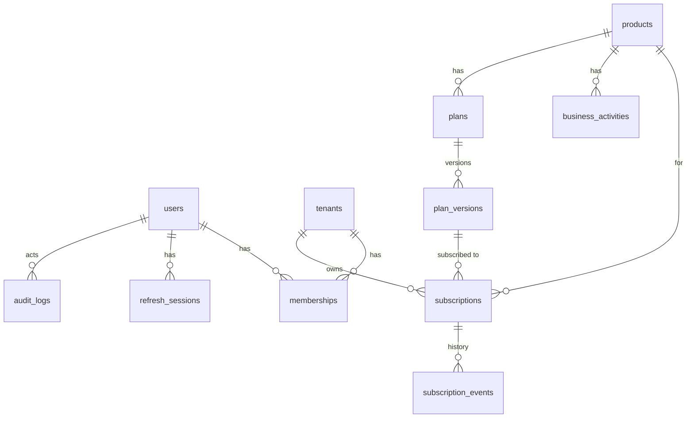

# ADR-0003: مخطط قاعدة البيانات الأولي وتدفق الصلاحيات

- **الحالة:** مقترح — بانتظار اعتماد المدير (لا تُنشأ جداول أعمال قبل الاعتماد)
- **التاريخ:** 2026-10-18
- **مرتبط بـ:** ADR-0002، `TASKS.md` (المرحلة A: «اعتماد مخطط قاعدة البيانات الأولي وتدفق الصلاحيات»، والأقسام 7 و8)

## السياق

قاعدة MariaDB وDrizzle والـ migrations جاهزة، لكن `backend/src/database/schema/` فارغ عمدًا. هذا المستند يقترح المخطط الأول وتدفق التفويض ليراجعهما المدير. يغطي ما يلزم للمراحل C (الحسابات والشركات) وD (الأنظمة والباقات والتجربة) فقط؛ الباقي مؤجل صراحة (انظر «خارج النطاق»).

> **افتراض مهم:** لم يُراجع كود STARK الفعلي بعد (بند منفصل في المرحلة A). أي نقطة تخص التكامل معه معلّمة كسؤال مفتوح.

## القرارات المقترحة

### 1. عزل الشركات (Multi-tenancy)

**قاعدة مشتركة مع عمود `tenant_id`** في كل جدول يخص شركة، مع الفرض في طبقة التطبيق (لأن MariaDB بلا Row-Level Security، انظر ADR-0002):

- كل وصول لبيانات شركة يمر عبر Repository يستقبل `tenantId` كوسيط إلزامي، ولا يوجد استعلام على جداول الشركات من خارج الـ Repositories.
- `tenant_id` يُؤخذ دائمًا من سياق المصادقة (العضوية)، **لا** من جسم الطلب أو الـ query.
- اختبارات عزل (شركة A لا تقرأ/تعدّل بيانات B) تُكتب قبل أول endpoint يقرأ بيانات شركة.
- **البديل المرفوض حاليًا:** قاعدة لكل شركة. تعقّد الـ migrations والنسخ الاحتياطي من غير حاجة مثبتة. يُعاد النظر فقط عند وجود متطلب تعاقدي صريح.

### 2. المعرّفات والأنواع

- معرّفات `char(36)` بصيغة **UUIDv7** تُولَّد في التطبيق (غير قابلة للتخمين، ومرتبة زمنيًا فلا تضرّ بالفهارس).
- التواريخ `datetime(3)` بتوقيت UTC.
- المبالغ **أعداد صحيحة بأصغر وحدة** (`price_minor`) مع عمود `currency`؛ ممنوع `float`.
- الحالات `varchar` مقيّدة بـ enum في الكود (Zod/Drizzle) بدل MariaDB ENUM لتسهيل الـ migrations.
- الحذف: **تعطيل (`status`)** وليس حذفًا فعليًا للكيانات الأساسية؛ سجل التدقيق لا يُحذف ولا يُعدَّل.

### 3. الكيانات (الإصدار الأول)

| الجدول | أهم الأعمدة | القيود والفهارس |
|---|---|---|
| `users` | `id`, `email` (مُطبَّع lowercase), `password_hash` (Argon2id), `status` (active/disabled), `platform_role` (nullable: owner/admin/support), `email_verified_at`, `created_at`, `updated_at` | `UNIQUE(email)` |
| `tenants` | `id`, `name`, `status` (active/suspended/closed), `created_at`, `updated_at` | — |
| `memberships` | `id`, `tenant_id`, `user_id`, `role` (owner/admin/member/read_only), `status` (invited/active/disabled), `created_at` | `UNIQUE(tenant_id, user_id)`، `INDEX(user_id)`، FK لكليهما |
| `products` | `id`, `code` (`stark`/`caprina`), `name`, `status` (available/coming_soon/disabled) | `UNIQUE(code)` |
| `business_activities` | `id`, `product_id`, `code`, `name`, `status` | `UNIQUE(product_id, code)` |
| `plans` | `id`, `product_id`, `activity_id` (nullable), `code`, `status` | `UNIQUE(product_id, code)` |
| `plan_versions` | `id`, `plan_id`, `version`, `price_minor`, `currency`, `billing_period`, `trial_days`, `limits` (JSON), `features` (JSON), `created_at` | `UNIQUE(plan_id, version)`؛ **غير قابل للتعديل بعد الإنشاء** |
| `subscriptions` | `id`, `tenant_id`, `product_id`, `plan_version_id`, `status` (trialing/active/past_due/canceled/expired), `trial_ends_at`, `current_period_end`, `canceled_at`, `created_at`, `updated_at` | `UNIQUE(tenant_id, product_id)`، `INDEX(status, current_period_end)` |
| `subscription_events` | `id`, `subscription_id`, `tenant_id`, `type`, `from_status`, `to_status`, `actor_user_id`, `created_at` | `INDEX(subscription_id, created_at)` |
| `refresh_sessions` | `id`, `user_id`, `family_id`, `token_hash`, `expires_at`, `revoked_at`, `replaced_by_id`, `user_agent`, `created_at` | `UNIQUE(token_hash)`، `INDEX(user_id)`, `INDEX(family_id)` |
| `audit_logs` | `id`, `actor_user_id`, `tenant_id` (nullable), `action`, `target_type`, `target_id`, `metadata` (JSON، بلا بيانات حساسة)، `request_id`, `created_at` | `INDEX(tenant_id, created_at)`، `INDEX(actor_user_id, created_at)`؛ إدراج فقط |

ملاحظات تصميم:

- **`plan_versions`** تحمي العقود القائمة: تعديل باقة = إنشاء نسخة جديدة، والاشتراك يشير إلى النسخة التي اشترك بها (يحسم جزئيًا سؤال «هل يسري التغيير على الاشتراكات الحالية؟»: افتراضيًا **لا**).
- **`UNIQUE(tenant_id, product_id)` في `subscriptions`:** صف واحد لكل شركة ونظام، والتاريخ في `subscription_events`. MariaDB لا تدعم فهارس فريدة جزئية، فهذا أبسط من فرض «اشتراك نشط واحد» بالكود فقط.
- **الميزات والحدود (Entitlements)** تُشتق من `plan_versions.limits/features` في الإصدار الأول بدل جدول مستقل؛ تُفصل لاحقًا إن لزم.
- **حالة النظام** (`products.status`) في قاعدة البيانات لا في الكود، لتفعيل CAPRINA لاحقًا دون إعادة نشر.
- `refresh_sessions`: refresh token **opaque عشوائي يُخزَّن مُجزَّأً (hash)** مع تدوير عند كل استخدام؛ إعادة استخدام توكن مُدوَّر تُبطل العائلة كلها (`family_id`).

### 4. الأدوار والصلاحيات

- **نطاقان منفصلان:**
  - **المنصة** (`users.platform_role`): Platform Owner / Platform Admin / Support (قراءة محدودة).
  - **الشركة** (`memberships.role`): Tenant Owner / Admin / Member / Read-only.
- صلاحية المنصة لا تمنح تلقائيًا وصولًا لبيانات شركة؛ دخول فريق AXOR إلى بيانات شركة يمرّ بإجراء إداري صريح ويُسجَّل في `audit_logs`.
- **RBAC بجدول ثابت في الكود** (`role → permissions`) في الإصدار الأول، مع اختبار لكل دور وكل عملية. جداول Role/Permission الديناميكية مؤجلة حتى تظهر حاجة فعلية لأدوار مخصصة.
- العميل لا يستطيع تعيين `role` أو `tenant_id` أو `price` أو `status` من الطلب (Mass Assignment: حقول مسموحة صراحة في كل schema).

### 5. تدفق التفويض لكل طلب

1. **المصادقة:** التحقق من الـ access token (JWT قصير العمر، لا claims حساسة)، وتحميل `users.status` من القاعدة (تعطيل الحساب يسري فورًا).
2. **سياق الشركة:** تحديد الشركة المطلوبة (من المسار/الهيدر) والتحقق أنها ضمن عضويات المستخدم `active`. لا يُقبل `tenant_id` من الـ body.
3. **التفويض:** فحص صلاحية الدور على العملية المطلوبة.
4. **الاستحقاق (Entitlement):** الاشتراك في حالة تسمح (`trialing`/`active`) والحد المطلوب لم يُتجاوز؛ مصدر الحقيقة الخادم.
5. **الوصول للبيانات:** عبر Repository مقيّد بـ `tenant_id`.
6. **التدقيق:** العمليات الإدارية والحساسة تُسجَّل في `audit_logs` (بدون كلمات مرور أو توكنات).

### 6. المصادقة

- كلمات المرور: **Argon2id**، ورسائل دخول واستعادة لا تكشف وجود الحساب.
- Access token قصير (مقترح 15 دقيقة)، وrefresh token في Cookie `HttpOnly; Secure; SameSite` مع حماية CSRF مناسبة؛ يُحسم الشكل النهائي مع تصميم الواجهة.
- rate limiting على الدخول والتسجيل والاستعادة (بند أمني منفصل).

## خارج النطاق (مؤجل)

الدفع الإلكتروني، `domains/deployments`، `notifications`، جداول أدوار ديناميكية، والتكامل التفصيلي مع STARK (ينتظر مراجعة كوده).

## أسئلة مفتوحة للمدير

1. هل يمكن للمستخدم الانتماء لأكثر من شركة؟ (المقترح: نعم عبر `memberships`).
2. هل التحقق من البريد شرط لبدء التجربة؟
3. قاعدة منع إساءة التجربة: تجربة واحدة لكل (شركة + نظام) فقط، أم أيضًا لكل بريد/مالك؟
4. سياسة تغيير الباقة: تسري على الاشتراكات الحالية أم الجديدة فقط؟ (المقترح: الجديدة فقط، والترقية بقرار صريح).
5. سياسة الاحتفاظ بالبيانات والحذف بعد إغلاق الشركة (المدة والمتطلبات القانونية).
6. هل لدى STARK نموذج شركات/مستخدمين خاص به؟ وهل يُربط بـ AXOR عبر معرّف الشركة أم عبر تكامل API؟ (ينتظر مراجعة STARK).

## الخطوة التالية بعد الاعتماد

تحويل المخطط إلى ملفات Drizzle في `backend/src/database/schema/` (ملف لكل كيان) وأول migration حقيقية، وكتابة اختبارات عزل الشركات قبل أي endpoint يقرأ بياناتها.
