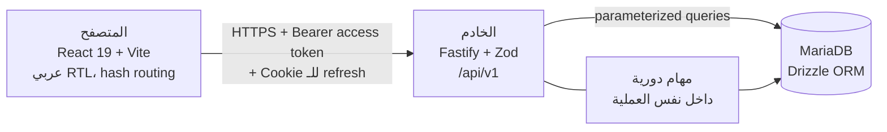

# معمارية AXOR: نظرة عامة

> **الحالة:** مكتوب من الكود الحالي ومن الـ ADRs (2026-11-14). الوثيقة بتوصف اللي **موجود فعلاً**، وأي حاجة لسه ما اتبنتش مكتوبة صراحة في قسم «لسه ما اتبنّاش». القرار نفسه مكانه `docs/adr/`، والوثيقة دي بتشاور عليه ومبتنسخهوش.

## الوثائق في المجلد ده

| الملف | بيغطي |
|---|---|
| `README.md` (ده) | المكونات والطبقات والوحدات والـ multi-tenancy والمهام الدورية |
| `identity-and-authorization.md` | تدفق الهوية: التسجيل والدخول والجلسات، وتدفق التفويض لكل طلب |
| `subscription-lifecycle.md` | التجارب والاشتراكات: الحالات والانتقالات والوصول والانتهاء |

## الصورة الكبيرة

AXOR منصة SaaS متعددة الشركات (multi-tenant) لإدارة الأنظمة والاشتراكات. أول نظام جواها هو STARK (الشحن)، وCAPRINA (النشاط التجاري) لاحقاً. الشركة بتسجّل، وبتختار نظام وباقة، وبتبدأ تجربة، وبتدير أعضاءها واشتراكاتها، وفريق المنصة بيدير الكتالوج والشركات والاشتراكات.



- **الواجهة** (`frontend/`): React وTypeScript وVite، بدون مكتبة routing؛ التنقل بـ hash (`#/plans` مثلاً) وقوائم المسارات المعروفة في `frontend/src/lib/routes.ts`. المجلدات حسب المنطقة: `auth` و`catalog` و`company` و`subscriptions` و`tenants` و`audit` و`public` و`components` و`lib` و`api`. الـ CSP صارمة (من غير inline script أو style)، ومحقونة وقت الـ build (ADR-0014).
- **الخادم** (`backend/`): Fastify وZod للتحقق وDrizzle فوق MariaDB (ADR-0002). كل المسارات تحت `/api/v1`.
- **المستودع:** monorepo بـ pnpm workspaces (`frontend` و`backend` والجذر)، والتسمية دي بدل `apps/*` بقرار ADR-0001.

## تنظيم كود الخادم

```
backend/src/
├── config/          # تحقق متغيرات البيئة بـ Zod، ورفض الإعدادات الضعيفة في الإنتاج
├── common/          # AppError وردود موحدة (ok())، UUIDv7، تنضيف الـ logs
├── database/
│   ├── schema/      # ملف لكل كيان (users, tenants, plans, subscriptions, ...)
│   ├── migrations/  # SQL قابل للمراجعة + checksums.json (forward-fix فقط، ADR-0009)
│   └── repositories/# كل الوصول للقاعدة
└── modules/
    ├── auth/          # تسجيل، دخول، refresh، تغيير كلمة المرور
    ├── authz/         # جدول الصلاحيات، Principal، TenantScope
    ├── catalog/       # قراءة عامة للأنظمة والباقات
    ├── subscriptions/ # تجارب واشتراكات الشركة + دورة الحياة + الاستحقاق
    ├── members/       # أعضاء الشركة وأدوارهم
    ├── admin/         # كتالوج واشتراكات وشركات وسجل تدقيق للمنصة
    ├── idempotency/   # Idempotency-Key على الكتابات غير القابلة للتكرار
    └── health/        # liveness وreadiness
```

**الطبقات:** المسار (`*.routes.ts`) يتحقق من المدخلات بـ `parseInput` ويفرض الصلاحية بـ `authorize`، وبعدها يستدعي الـ repository أو الدوال النقية (`subscription-state.ts`, `entitlements.ts`, `member-policy.ts`). الوصول للقاعدة محصور في `database/repositories/` وعبر query builder بتاع Drizzle (حارس ساكن بيفشل لو ظهر SQL خام، بند SQL injection في TASKS.md §9).

**ربط الاعتماديات (DI يدوي):** `server.ts` هو نقطة التركيب الوحيدة (composition root): بيبني الاتصال بالقاعدة والـ repositories وخدمة المصادقة، وبيمررهم لـ `buildApp(env, deps)`. وكل وحدة مسارات هي دالة بتاخد اللي محتاجاه من `deps` (`authRoutes(deps.auth, env)` و`membersRoutes(deps.auth, deps.members)` ...)، فمفيش singletons مخفية، والاختبارات بتبني التطبيق بـ `deps` خاصة بيها (مثلاً `buildApp(env, { checkDatabase })` في `app.test.ts`).

> **ملاحظة صريحة:** فصل Controller عن Service مطبّق في المصادقة (`auth.service.ts`) بس. باقي الوحدات منطقها موزع بين ملف المسارات والـ repository والدوال النقية، من غير طبقة service مستقلة. ده متوافق مع الكود الحالي لكن مش مطابق للهيكل المقترح في TASKS.md §3 و§4.1، فبنود الفصل دي لسه مفتوحة.

## عزل الشركات (Multi-tenancy)

قاعدة مشتركة مع `tenant_id` والفرض في التطبيق، لأن MariaDB مفيهاش Row-Level Security (ADR-0003 §1). القواعد:

1. المستخدم ينتمي لشركة واحدة بس (`users.tenant_id`) أو يكون موظف منصة من غير شركة (CHECK في القاعدة).
2. **`tenant_id` بييجي من المستخدم المصادَق دايماً، مش من الطلب** (لا header ولا body ولا query).
3. كل وصول لبيانات شركة بيمر عبر `TenantScope` اللي مبيتبنيش إلا من المستخدم المصادَق، والـ repositories المقيّدة بيه بتضيف `tenant_id` لكل استعلام.
4. التعطيل بدل الحذف الفعلي، و`audit_logs` إدراج فقط.

## المهام الدورية

التلات مهام بتشتغل جوه نفس عملية الخادم (`server.ts` عن طريق `startExpiryJob`) وبتتقفل بشكل نضيف مع إيقاف الخادم:

| المهمة | بتعمل إيه | مرجع |
|---|---|---|
| انتهاء الاشتراكات | بتحوّل الاشتراكات المنتهية لـ `expired` على دفعات، وبتسجّل حدث وaudit | ADR-0007 §7 |
| تنضيف جلسات الـ refresh | بتحذف الجلسات المنتهية بعد فترة سماح 7 أيام | ADR-0025 |
| تنضيف مفاتيح idempotency | بتحذف الردود المخزّنة بعد عمرها (24 ساعة)، من غير فترة سماح | ADR-0026 |

مهمة انتهاء الاشتراكات مصممة تشتغل من أكتر من instance بأمان (`SKIP LOCKED` بيتخطى الصفوف اللي instance تانية ماسكاها، ADR-0007 §7)؛ مهمتا التنضيف بتحذف على دفعات محدودة ولسه ما اتجرّبوش من أكتر من instance. ومع ده **العدّاد بتاع تقييد محاولات الدخول لسه في ذاكرة العملية**، فتعدد الـ instances محتاج مخزن مشترك قبله (ADR-0004 §6).

## الحدود والحماية العامة

- حجم الطلب 64 كيلوبايت وJSON بس، ومهلة استلام الطلب، ومهلة تنفيذ الـ handler (`504`)، ومهلة الاستعلام في القاعدة (`503`)، وحد pool الاتصالات (ADR-0015 وADR-0019 وADR-0020).
- ردود موحدة: النجاح `{ data, meta? }` والخطأ `{ error: { code, message } }` من غير stack أو تفاصيل داخلية.
- logging منظّم بـ request id، وقناع للـ IP، وإخفاء الحقول السرية، ومنع تسريب أخطاء القاعدة (TASKS.md §9، ADR-0016).
- CI على كل push للفرع الرئيسي وعلى كل pull request: typecheck وlint واختبارات وbuild، وdependency audit، وفحص أسرار على تاريخ git كله (`.github/workflows/ci.yml`).

## لسه ما اتبنّاش (عشان الوثيقة متبقاش وعد)

- **ربط STARK:** مفيش تكامل فعلي. `isEntitled` موجودة ومختبرة لكن مش مربوطة بالوصول لأي نظام (المرحلة F).
- **الدفع الإلكتروني** وحالة `past_due` (جاهزة في دورة الحياة، ومفيش حاجة بتنتجها).
- **البريد:** مفيش مزوّد بريد؛ استعادة كلمة المرور والتحقق من البريد ودعوات الأعضاء مستنيين قرار (التصميم في `docs/designs/password-reset-email-verification.md`).
- **الدومينات والنسخ المستقلة** (TASKS.md §16).
- **النشر:** منصة الاستضافة وHTTPS والأسرار وstaging لسه ما اتقررتش (`docs/runbooks/deploy.md`).
