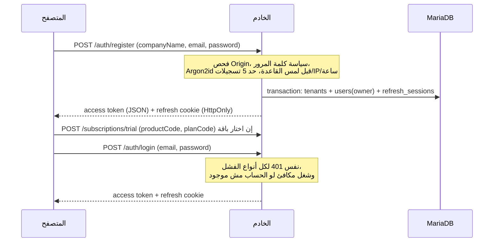
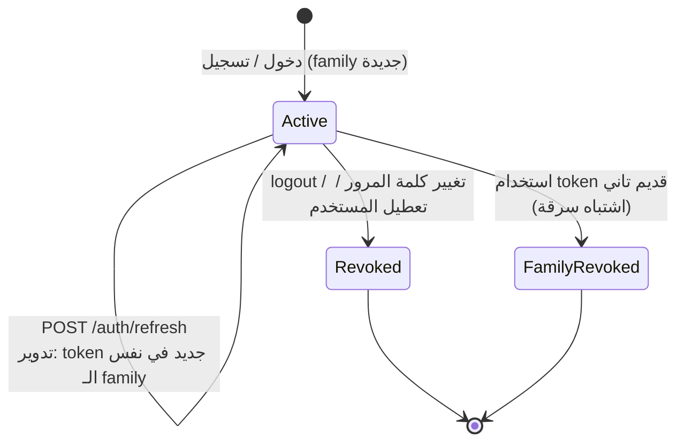
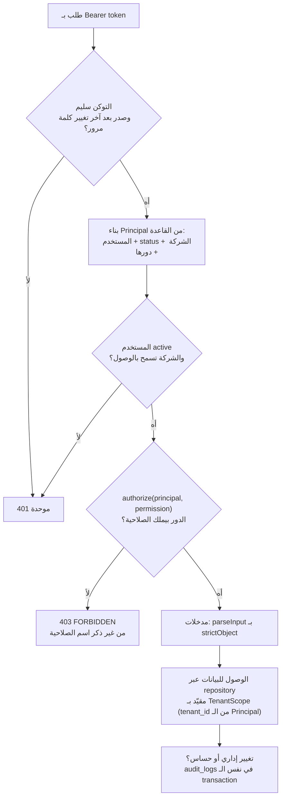

# تدفق الهوية والتفويض

> **المصدر:** ADR-0003 (§4 و§5 و§7) وADR-0004 والكود في `backend/src/modules/auth/` و`backend/src/modules/authz/` (2026-11-14). لو فيه تعارض، الـ ADR والكود هما المرجع، والوثيقة دي ملخص.

## مين اللي بيدخل النظام

مستخدم واحد = نطاق واحد (CHECK في جدول `users`):

| النطاق | الأدوار (`users.*_role`) | ملاحظات |
|---|---|---|
| **شركة** | `owner` و`admin` و`member` و`read_only` | مرتبط بـ `users.tenant_id`، وشركة واحدة بس لكل مستخدم |
| **منصة AXOR** | `owner` و`admin` و`support` | من غير شركة. دور المنصة مبيدّيش وصول لبيانات شركة تلقائياً |

الأدوار مكتوبة في الكود (جدول ثابت في `permissions.ts`) مش في القاعدة، ومفيش أدوار مخصصة.

## 1. التسجيل والدخول

- **التسجيل:** الشركة والمالك بيتعملوا في transaction واحدة. الـ body صارم (`companyName` و`email` و`password` بس)، وأي `role` أو `tenantId` أو `status` من العميل = 400. بريد محجوز = 409 (قرار معروف ومخفف بحد معدل، ADR-0004 §10).
- **الدخول:** Argon2id (19 MiB، t=2، p=1). كل أنواع الفشل (بريد غلط، كلمة سر غلط، مستخدم معطل، شركة موقوفة) بترجع نفس الـ 401 والرسالة. بعد 5 محاولات فاشلة لكل (IP + بريد) أو 30 لكل بريد في 15 دقيقة بيرجع 429 مع `Retry-After`.
- **الأحداث:** `auth.login` و`auth.login_failed` (لحساب معروف بس) و`auth.logout` و`auth.refresh_reuse_detected` و`tenant.registered` بتتسجل في `audit_logs` من غير كلمات مرور أو tokens.

## 2. الجلسة: access token وrefresh token

| | Access token | Refresh token |
|---|---|---|
| الشكل | JWT HS256، عمره 15 دقيقة افتراضياً | قيمة عشوائية opaque (32 بايت) |
| المحتوى | هوية فقط (`sub` و`jti` و`iat` و`exp` و`iss` و`aud`): **مفيش دور ولا شركة** | بيتخزن في القاعدة كـ SHA-256 بس |
| مكانه | `Authorization: Bearer`، والواجهة بتحتفظ بيه في الذاكرة بس | Cookie: `HttpOnly` و`SameSite=Strict` و`Path=/api/v1/auth`، و`Secure` بالاسم `__Secure-axor_rt` في الإنتاج |
| عمره | 15 دقيقة | 30 يوم افتراضياً |

- **التدوير:** كل refresh بيصدر token جديد في نفس `family_id` ويلغي القديم داخل transaction بـ `SELECT … FOR UPDATE`. استخدام token اتلغى بيلغي العائلة كلها ويسجّل `auth.refresh_reuse_detected`. طلبين refresh متزامنين بنفس الـ token: واحد ينجح والتاني يفشل، فالواجهة بتسلسل طلبات الـ refresh.
- **شكل الكوكي بيتفحص** (43 حرف base64url بالظبط) قبل أي hash أو lookup، والـ Bearer حده 2048 حرف.
- **CSRF:** فحص `Origin` يساوي `WEB_ORIGIN` بالظبط على كل POST في `/auth`، فوق `SameSite=Strict`.
- **تغيير كلمة المرور** (`POST /auth/change-password`): بيلغي كل الـ refresh sessions ويعمل `password_changed_at`، وأي access token اتصدر قبله بيتقفل بنفس الـ 401، والجهاز اللي غيّر بياخد جلسة جديدة.
- **تنضيف:** الجلسات المنتهية بتتحذف بعد 7 أيام سماح (ADR-0025).
- **تدوير السر:** `JWT_ACCESS_SECRET_PREVIOUS` بيخلّي التحقق يقبل السر القديم أثناء التدوير والتوقيع بالحالي بس (ADR-0017). الخطوات في `docs/runbooks/deploy.md`.

## 3. التفويض لكل طلب محمي

1. **المصادقة:** التوكن مفيهوش أدوار، فتعطيل المستخدم أو الشركة أو تغيير الدور بيسري فوراً لأن الـ Principal بيتبني من القاعدة في كل طلب (استعلام واحد لكل endpoint محمي).
2. **الصلاحية قبل المدخلات:** `authorize` بيتنفذ قبل `parseInput`، فمدخل غلط مبيكشفش مسار الدور مش مسموح له بيه (403 مش 400). ده مختبر في `route-guard.integration.test.ts`.
3. **الرفض افتراضي:** مسار جديد من غير تصنيف في جرد حارس المسارات بيكسر الاختبار، فمفيش endpoint بيتضاف من غير قرار صريح عن صلاحيته.
4. **العزل:** `tenant_id` من المستخدم المصادَق، ومبيجيش من الطلب أبداً.

### جدول الصلاحيات

**الشركة:**

| الصلاحية | owner | admin | member | read_only |
|---|:-:|:-:|:-:|:-:|
| `tenant:read` | ✓ | ✓ | ✓ | ✓ |
| `tenant:update` | ✓ | ✓ | | |
| `users:read` | ✓ | ✓ | ✓ | |
| `users:invite` / `users:update` / `users:disable` | ✓ | ✓ | | |
| `subscription:read` | ✓ | ✓ | ✓ | ✓ |
| `subscription:manage` | ✓ | | | |
| `audit:read` | ✓ | ✓ | | |

**المنصة:**

| الصلاحية | owner | admin | support |
|---|:-:|:-:|:-:|
| `platform:tenants:read` | ✓ | ✓ | ✓ |
| `platform:tenants:manage` | ✓ | ✓ | |
| `platform:plans:manage` | ✓ | ✓ | |
| `platform:subscriptions:read` | ✓ | ✓ | ✓ |
| `platform:subscriptions:manage` | ✓ | ✓ | |
| `platform:users:read` | ✓ | ✓ | ✓ |
| `platform:audit:read` | ✓ | ✓ | |
| `platform:tenant-data:access` | ✓ | ✓ | |

> الجدولين منقولين من `backend/src/modules/authz/permissions.ts` (2026-11-14). الاختبارات بتفحص كل دور مقابل كل صلاحية، وبتتأكد إن مفيش دور شركة بيملك صلاحية منصة ولا العكس. لو الكود اتغيّر، الكود هو المرجع.

قواعد إضافية على الأعضاء (ADR-0011): الأدمن يعدّل `member` و`read_only` بس، وآخر owner نشط ما يتعطّلش ولا يتخفّض، وتعطيل العضو بيلغي كل جلساته، وإعادة التفعيل بتفحص حد المستخدمين في الباقة (ADR-0012).

## لسه ما اتبنّاش

- استعادة كلمة المرور والتحقق من البريد ودعوات الأعضاء (مستنيين مزوّد بريد وقرار، التصميم في `docs/designs/password-reset-email-verification.md`).
- MFA لحسابات الإدارة، وإنهاء كل جلسات مستخدم يدوياً من الإدارة.
- مخزن مشترك للعدّاد بتاع تقييد الدخول (لو الخادم اتشغّل بأكتر من instance).
- إعداد `TRUST_PROXY=true` لازم يتفعّل في الإنتاج لو الـ API ورا reverse proxy، وإلا حدود المعدل هتتحسب على IP الـ proxy نفسه (ADR-0004 §8).
