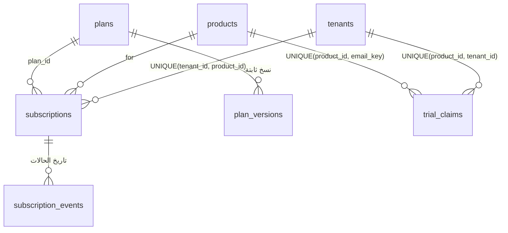
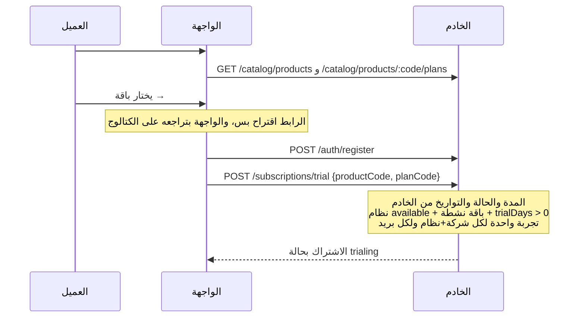
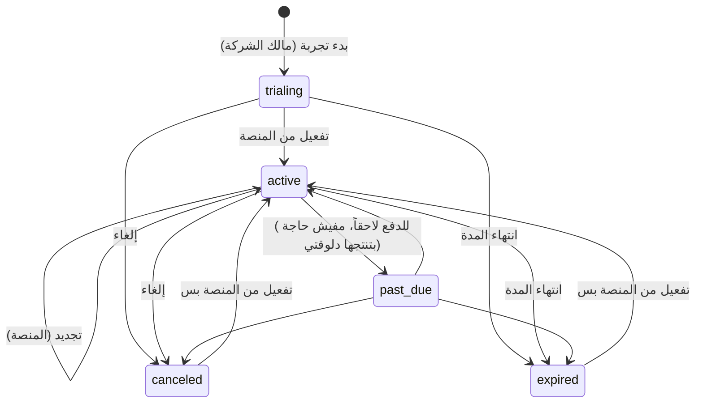

# دورة حياة التجارب والاشتراكات

> **المصدر:** ADR-0003 (§3) وADR-0007 وADR-0012، والكود في `backend/src/modules/subscriptions/` (2026-11-14). الدفع الإلكتروني **مش موجود لسه**؛ التفعيل والتجديد بيتعملوا يدوي من لوحة المنصة.

## الكيانات

- **اشتراك واحد لكل شركة ونظام** (`UNIQUE(tenant_id, product_id)`)، والتاريخ في `subscription_events`.
- **الباقة نسخ:** تعديل السعر أو الحدود أو الميزات = نسخة جديدة في `plan_versions` (مبتتعدلش بعد إنشائها) وتحريك `plans.current_version_id`. الاشتراك بيستحق **النسخة الحالية** للباقة (تغيير الباقة بيسري على الحاليين فوراً، قرار المدير #4 في ADR-0003)، إلا لو المنصة ثبّتت نسخة بعينها (`pinned_plan_version_id`).
- **مدة التجربة** بتيجي من `trial_days` في نسخة الباقة، مش من العميل.

## رحلة العميل لحد التجربة

- لو بدء التجربة فشل بعد التسجيل، الحساب بيفضل سليم والمالك بيروح لـ `#/start?trial=failed` بتنبيه ثابت (ADR-0007 §15).
- نظام «قريباً» بيتعرض من غير زرار اشتراك، والخادم بيرفضه لو اتطلب (ADR-0007 §3).

## الحالات والانتقالات

الدالة النقية `subscription-state.ts` هي المرجع الوحيد للانتقالات:

- تجربة منتهية **مبترجعش** `trialing`، والإلغاء مبيرجّعش التجربة (محجوزة في `trial_claims`).
- كل تغيير حالة: قفل الصف (`FOR UPDATE`) ← فحص الانتقال ← تحديث ← حدث في `subscription_events`، كله في transaction واحدة. التغييرات البشرية بتتسجل كمان في `audit_logs` في نفس الـ transaction، ولو الـ audit فشل التغيير بيتلغي.

## مين يقدر يعمل إيه

| العملية | المسار | الصلاحية |
|---|---|---|
| عرض اشتراكات الشركة | `GET /subscriptions` | كل أدوار الشركة (مستخدم المنصة 403) |
| بدء تجربة | `POST /subscriptions/trial` | `subscription:manage` (مالك الشركة) |
| إلغاء من الشركة | `POST /subscriptions/:productCode/cancel` | `subscription:manage` |
| عرض كل الاشتراكات | `GET /admin/subscriptions` | `platform:subscriptions:read` |
| تفعيل / تجديد بتاريخ نهاية | `POST /admin/subscriptions/:id/activate` | `platform:subscriptions:manage` |
| تمديد تجربة (1 إلى 90 يوم) | `POST /admin/subscriptions/:id/extend-trial` | `platform:subscriptions:manage` |
| إلغاء من المنصة | `POST /admin/subscriptions/:id/cancel` | `platform:subscriptions:manage` |

التفعيل اليدوي لازم تاريخ نهاية في المستقبل وبحد أقصى 5 سنين. تمديد التجربة وإضافة نسخة باقة بيقبلوا رأس `Idempotency-Key` عشان إعادة الإرسال متنفذش العملية مرتين (ADR-0026).

## الوصول: الحالة والتاريخ معاً

`isEntitled` بترجّع `true` لـ `trialing` أو `active` بس، **وبشرط** إن تاريخ النهاية موجود وبعد دلوقتي. يعني:

- الوصول بيقف عند تاريخ النهاية بالضبط حتى لو مهمة الانتهاء ما اشتغلتش.
- تاريخ نهاية ناقص مبيدّيش وصول أبداً.
- `canceled` و`expired` و`past_due` من غير تاريخ ساري = مفيش وصول، والواجهة بتعرض رسالة بتقول للشركة تكلّم الدعم.

**مهمة الانتهاء** (`expireDue`) كل دقيقة: بتحوّل الاشتراكات المنتهية لـ `expired` على دفعات (500)، وبتكتب حدث في `subscription_events` وصف `subscription.expired` في `audit_logs` بمنفّذ فاضي (النظام)، وبتتخطى الصفوف اللي instance تانية ماسكاها (`SKIP LOCKED`).

## حدود الباقة (الاستحقاقات)

الحدود والميزات متخزنة في `plan_versions` (JSON) ومحسوبة من النسخة الفعّالة. **الوحيد المربوط بالتنفيذ دلوقتي هو حد `users`** (ADR-0012): إعادة تفعيل عضو معطّل بتفحص الحد في الباقات اللي بتدّي وصول (الأكرم يكسب، و`null` = غير محدود، المنتهي والملغي مابيحسبوش، و`active` و`invited` بياخدوا مقعد). لو مفيش مقعد: 409 بكود `PLAN_LIMIT_REACHED`.

## لسه ما اتبنّاش

- **ربط `isEntitled` بالوصول الفعلي لأي نظام** (STARK): القاعدة موجودة ومختبرة بس مفيش نظام بيستخدمها (المرحلة F).
- **باقي الحدود والميزات** (زي `shipments_per_month`) والترقية وتغيير الباقة من الشركة.
- **الدفع الإلكتروني** وإنتاج `past_due` تلقائياً، وإشعارات قرب انتهاء التجربة (المرحلة H).
- **تثبيت اشتراك على نسخة معيّنة** من اللوحة (العمود موجود، ومفيش endpoint).
- فحص عدد المستخدمين الحاليين عند تفعيل أو تغيير اشتراك من المنصة.
- **إزاحة التوقيت** في أعمدة `DEFAULT CURRENT_TIMESTAMP(3)` (اتكشفت 2026-11-07)، محتاجة قرار قبل ما `created_at` تُستخدم في أي عرض أو مقارنة.
